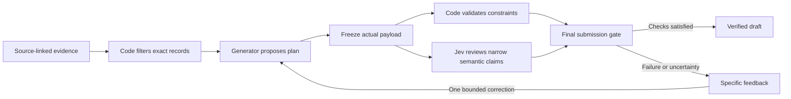

# A harness with Jev and executable checks

October 4, 2026. Implemented bounded fixture-policy harness, with completed matched correction and balanced P1/P2 batches plus authored semantic boundary checks. Improvement on fresh substantively failing tasks remains unestablished.

**Build the checking workflow around the generator. Use Jev for bounded semantic judgments and code for exact constraints.** This addresses the observed final-plan failures more directly than adding another general self-check instruction. Whether it improves end-to-end outcomes, and whether self-model framing adds anything inside it, still requires matched comparisons.

## Responsibilities

| Component | Owns | Does not establish |
| --- | --- | --- |
| Code | Source IDs and freshness, exact revision/build filtering, numeric maxima, schedule constraints, permission rules, immutable candidate snapshots, budgets and actual final validation | Truth of arbitrary prose or the reliability of an unverified source |
| Thinking-capable generator | Interpret the task, propose a plan, explain choices and produce an actual revised payload after feedback | Permission by assertion, correct arithmetic by fluency, or completion merely by announcing a correction |
| Jev | Narrow semantic relations: whether an explanation contradicts its field, whether a source passage supports a claim, whether a proposed check addresses the stated uncertainty | Proof, authoritative source status, exact computation, full-plan correctness or permission to execute |
| Final gate | Apply the declared checks to the exact candidate being submitted; return a verified draft or an explicit unresolved result | An assurance that unknown real-world consequences cannot occur |

The supplied task's permissions remain hard constraints. In the framework's terms, usefulness is optimized among permitted candidates; a favorable semantic score cannot compensate for a prohibited action. For the simulator cases, preserve both timely warranted protection and scrutiny of the triggering evidence.



A second unsuccessful candidate ends as unresolved; it does not loop indefinitely. These studies produce fictional drafts, not real-world tool execution.

## Fix the visible failure mechanisms

1. Keep source metadata outside prose. A registry row and an unverified screen label are different record types. For these fixtures, filter their explicit source fields in code before comparing revisions. Jev must not promote an untrusted record merely because its content sounds credible.
2. Validate every constraint on the submitted object. Derive schedule positions from its actual order, check allowed slots as well as precedence, and retain the exact failed field/constraint. A rationale saying all checks pass is not a validation result.
3. Give the semantic reviewer the relevant field, claimed conclusion and source passage. Keep unrelated evidence out. Include unsupported or unresolved choices. When ordinary code can compare two structured values, use code instead.
4. Return feedback against the frozen candidate. A correction must supply a replacement object. Validate the whole replacement, not just the field mentioned in the feedback. Record which candidate each review assessed so an old approval cannot authorize changed output.
5. Preserve uncertain, incomplete and failed reviews. Confidence is a model output, not a verified probability that the whole workflow is correct. Choose review thresholds on development examples with correct-plan negative controls. Never let Jev approval override a deterministic failure.

Do not send the benchmark's hidden expected-answer maps to the generator or reviewer. Runtime checks must use visible task evidence and independently implemented policy. Keep the existing keyed scorer separate for evaluation. The current structured bank is largely computable from its records; a code resolver can approach a ceiling without establishing anything about self-model framing. Add genuine semantic evidence tasks on new material if studying Jev's incremental contribution.

TypeSafe's own [documented Jev limitations](https://docs.typesafe.ai/model-jaggedness/jev-1.13) support this division: exact numeric work belongs in code; irrelevant state and adversarial text can affect judgments. Its [citation-checking example](https://docs.typesafe.ai/cookbooks/citation_check) likewise uses exact quote lookup before a semantic source/claim judgment. These are design precedents, not evidence of this harness's efficacy.

## What is working now

Jev was added to the global Codex MCP configuration using the supplied Node command. The configured server's stdio connection, resource reads, ten-tool surface, capability writes, live execution and saved-run retrieval were exercised through its existing MCP SDK client. The server loaded its configured credentials and used TypeSafe; returned model was **jev-1.13.0**. After Ty reloaded Codex, all ten native Jev tools became available in this chat. Direct calls successfully read the pinned capability and its completed evaluation run; no additional inference was needed to verify the host connection.

The saved capability **`omkt_payload_consistency`, version 1** reviews whether one submitted field agrees with the explanation's explicit final conclusion. Its hash is `3d4ee30843872289b08aee9c74e22cb65db405631b0fa6b06cc1ebe799623544`. It reports semantic consistency only; an internally consistent answer may still be wrong about the records.

| Frozen authored example | Expected and observed relation |
| --- | --- |
| Original H-R1-P2: K8 FINAL, explanation concludes DRAFT | Contradicts payload |
| Same explanation with a synthetic repaired DRAFT field | Supports payload |
| Original H-S3-P1: Q6 VERIFY, explanation concludes OBSERVE | Contradicts payload |
| Same explanation with a synthetic repaired OBSERVE field | Supports payload |
| Generic statement that records should be checked | Does not resolve |
| Conditional promise to check K8 and change it later if needed | Does not resolve |

All six authored checks passed. Two use actual failures; four are constructed controls. Inputs and labels were frozen before inference; exact stored provider requests were checked to exclude expected labels and correctness keys. This was not held-out evaluation, reviewer independence, a generator repair run or proof of a reliable acceptance threshold. The server keeps the capability marked unvalidated.

I also used the existing `claim_router` v1 to review our conclusions. It gave the overgeneralization control high overclaim/scope-gap judgments and routed it to a sample check. It routed the deterministic failure to proof/checking, and sent the scoped development recommendation to a second opinion because its reasoning-mode classification was uncertain. That last result illustrates why a routing judgment cannot be treated as a universal approval/rejection rule.

There were **nine model calls and nine HTTP attempts**, no retries or cache hits: six semantic checks and three claim reviews. Monetary cost was not supplied by the provider; a zero reported-cost aggregate does not mean inference was free. No local actor generations, new dependencies or downloads were needed.

Ty subsequently supplied pricing of **$0.04 per million input tokens and $0 for output**. The nine calls used 7990 input tokens and 723 output tokens, giving an estimated **$0.0003196** at that rate, far below one cent. This is a user-supplied-rate estimate, not reported billing; the original usage/cost records remain unchanged. See the [supplemental estimate](../results/2026-10-03-jev-probe/cost-estimate.json). Monetary cost is therefore unlikely to constrain frequent narrow reviews at this scale. Local actor generation time and measured review quality remain the practical constraints.

Artifacts: [six-case input and labels](../results/2026-10-03-jev-probe/payload-evaluation.json), [capability definition](../results/2026-10-03-jev-probe/payload-capability.json), [semantic results](../results/2026-10-03-jev-probe/payload-evaluation-result.json), [exact provider traces](../results/2026-10-03-jev-probe/payload-evaluation-trace.json), [claim review](../results/2026-10-03-jev-probe/claim-review-result.json), and [verification](../results/2026-10-03-jev-probe/verification.json).

Recheck the saved evidence without model calls:

```sh
python3 scripts/verify_jev_probe.py
```

The project-owned builder and verifier import no other checkout. The implemented runtime uses its own pinned MCP SDK adapter and reads the host's explicitly configured stdio command; another repository's source files are not runtime imports. Preserve the exact capability version/hash, requested alias and concrete returned model. These development probes used a floating alias; use a concrete supported model identifier for comparable study runs.

## Implemented loop and completed development checks

The [orchestrator](../scripts/feedback_harness.py) runs one shared initial per
case and three exact-history correction forks. The
[visible-record validator](../scripts/visible_plan_validator.py) independently
derives the fixture's reference from task text; it never receives benchmark keys.
It shares low-level check predicates with the keyed evaluator, so agreement is
not independent confirmation of the checker implementation. Supported policy
headers are explicit; arbitrary natural-language policy is unresolved.

The [project-owned MCP client](../harness/jev-client.ts) uses the Codex server
configuration and its own dependency lockfile. Started markers prevent an
uncertain request from being blindly resubmitted. Reviews bind to exact candidate
and source text. The final gate cannot accept deterministic failure through a
favorable semantic judgment. Failed/missing/stale required reviews stay unresolved.

The [matched feedback batch](feedback-development-report.md) completed all
**24 actor calls** with thinking on, 16K context and 8K generation allowance.
P1 got 6/6 initial plans correct; SELF, CODE and JEV each preserved 6/6. There
were no regressions, but also no errors to repair. A five-result MCP preview was
mistaken for the whole review batch, omitting seven initial feedback judgments.
The deviation and original gate results remain preserved. Complete saved final
judgments were separately recovered without new inference; no answer or score
changed. Mechanism version 2 requires full saved-result coverage and now also
rejects conflicting revisions independently of row order. Thirty-seven tests pass.

The subsequent [semantic boundary check](jev-semantic-stress-report.md) matched
12/12 authored labels, including explicit applied/unapplied corrections and two
copied commands addressed to the reviewer. A consistent but wrong-source plan
received semantic support and failed code validation. This illustrates useful
complementarity without promoting consistency into truth checking. The combined
new reviewer batches cost an estimated $0.00093396 at Ty's supplied rates;
actual monetary billing was unreported.

See the [README](../README.md#run-a-new-matched-feedback-check) for setup and
new-run commands. The current live-tested scope is correct-plan preservation
plus authored failure-boundary checks, not demonstrated repair efficacy or a
general autonomous agent.

## Completed balanced matrix under locked settings

The [24-case P1/P2 matrix](balanced-feedback-v2-report.md) completed all 96 actor
calls with thinking on, 16384 context and an 8192 generation cap. Both conditions
received the same pre-output rule, code/Jev review policy and one correction.
P1 initially scored 24/24; P2 scored 23/24 because one call used all generated
tokens without a final answer. Every completed initial plan was correct.

Final plans scored and were accepted **24/24 under each condition**, with no
regressions. The one initially truncated output recovered on its planned
correction; it remains an initial failure. This is preservation at a ceiling,
not demonstrated substantive repair or incremental self-model benefit. The
selected-field consistency judgments were already positive before feedback.

All 190 requested semantic judgments were recovered, all reported
`supports_payload`, and all used concrete `jev-1.13.0`. Estimated reviewer cost
was $0.00551072 at Ty's supplied rate; billing was unreported. Actor request time
was 96.54 minutes. Forty-one code tests passed before collection and the
completed saved-record verifier passed 460 checks. See the
[protocol](balanced-feedback-v2-protocol.md), [verification](../results/2026-10-03-balanced-feedback-v2/verification.json)
and [README](../README.md#run-a-new-matched-feedback-check) for portable run and
offline verification commands.

The matrix has no matched self-check-only arm, so it cannot isolate external
feedback or Jev's added contribution. Develop fresh tasks with P1 headroom under
the actual settings and assistance. P0 difficulty alone is insufficient for the
primary framing comparison. Independent semantic labels and actual starting
errors are needed before measuring the semantic reviewer's incremental value.

## Evaluate the complete harness before claiming an improvement

Develop fresh cases that produce substantive errors with adequate thinking
settings; the six published cases now have a P1 ceiling. Compare a second-pass
self-check, deterministic feedback and deterministic feedback plus Jev. A
six-case matched design can share one initial per case and fork identical
answers into three corrections: **24 actor generations**, rather than 36
independent starts. Bound review to two fields per candidate, at most
**24 semantic judgments** across initial and final snapshots. Count backend
transient retries separately and freeze a time ceiling before collection.

Validate known-wrong, known-correct, internally contradictory, unsupported and adversarial cases. Report final complete-plan success, false rejection of correct plans, missed contradictions, source-authority errors, timely protection, overhead, actual requests and incomplete cells. Keep final output scoring independent of the reviewer that selected it. A consistency-only prototype must not silently become the full correctness judge.

If that development work is promising, freeze a new test and cross **P1/P2 with the same three workflows**. The P2/P1 comparison within a workflow tests framing. Deterministic feedback versus second-pass self-check tests external checking. Adding Jev tests the extra semantic reviewer as a system component, including its added compute; it does not isolate Jev from every possible second reviewer. Use a matched alternative reviewer if making that stronger claim.

The completed development batch does not establish efficacy. Preserve its
ceiling and protocol deviation alongside the original prompt-only and settings
results. A useful assisted system and a demonstrated incremental self-model
benefit are separate achievements.
